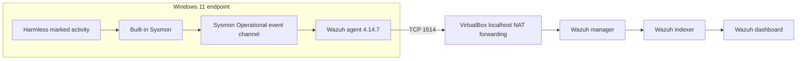

# Architecture

The Wazuh server is an all-in-one Ubuntu Server VM in VirtualBox. NAT forwarding binds Wazuh agent and enrollment ports to localhost, limiting their exposure to the Windows host. The existing lab architecture is reused; this project adds Sysmon as a new endpoint data source.

## Trust boundaries

- Sysmon records endpoint activity but does not determine whether it is malicious.
- The Wazuh agent reads the Windows event channel and transports events to the manager.
- Wazuh decoders and rules determine which events become alerts.
- Sanitized portfolio evidence is derived from local and Wazuh records; raw logs remain outside Git.
